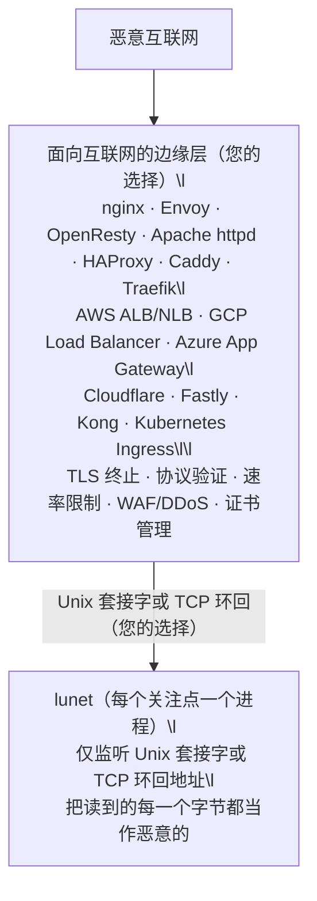

# 安全架构

lunet 推荐 qmail 风格的进程隔离架构 - 这正是让 qmail 在十多年间成为最安全邮件服务器的方法。

核心原则：将系统分解为信任边界，每个进程具有最小权限，并通过受限接口进行通信。面向互联网的攻击面由经过加固、久经考验的软件处理 - 云负载均衡器、API 网关，或本地 sidecar（nginx、OpenResty、HAProxy、Traefik、Caddy、Envoy）；lunet 永远不直接接触恶意网络。



## 这套架构里验证在哪里发生

边缘层移除的是 lunet 的**网络暴露面**：互联网上未认证的攻击者根本够不到 lunet 的套接字。对于边缘层原生讲的协议（HTTP/1.1、HTTP/2、HTTP/3、WebSocket），它在交接之前验证协议，所以到达 lunet 的东西已经由一个讲该协议的组件检查过了。这正是 qmail 模型的核心。

对于其他一切，边缘层只转发字节：L4 负载均衡器看到的是包，不是协议；L7 代理只验证它自己讲的协议，不验证 lunet 讲的协议。在这些部署里，lunet 自己的协议层做验证。这样的分工是有意为之：每条线上的协议只被检查一次，由该跳上讲它的那个组件检查。

lunet 读到的每一个字节，无论部署在哪里，都遵守这条常备纪律：

- **先边界，后分配。** 声明的长度设上限，永不信任；长度前缀与帧检查在分配或复制之前运行。
- **约束进程。** 以专用非根 UID/GID 运行 lunet；让 Unix 套接字的文件系统权限匹配它；平台允许之处施加 seccomp 或等效的系统调用过滤。
- **让探针保持绿色。** 解析器套件与 Http11Probe 装置固化了文档化结果；新增解码器时保持模糊测试覆盖增长。

用 qmail 的话说：边缘层是面向网络的守卫，而每个组件仍假设自己的输入是恶意的。纵深防御正是这套架构的意义：边缘层是第一道边界，不是唯一一道。

## 约束进程：部署运行手册

上文“约束进程”条目是策略；本节是具体操作。在每台主机上三层都要落实。

### 专用非根 UID/GID

为 lunet 进程创建专用账户与组；永远不要以 root 运行，也不要与其他服务共享该账户。

```sh
groupadd --system lunet
useradd --system --gid lunet --home-dir /var/lib/lunet --create-home --shell /usr/sbin/nologin lunet
```

macOS 使用 `dscl`/`sysadminctl` 等效命令；Windows 使用具有“作为服务登录”权限的专用服务账户。升级时保持该账户的 UID/GID 稳定，以免套接字属主漂移。

### Unix 套接字权限

将 lunet 绑定到由专用账户拥有的 Unix 套接字，模式 `0660`，放在同属该账户、模式 `0750` 的目录中：

```sh
install -d -o lunet -g lunet -m 0750 /run/lunet
# lunet 创建 /run/lunet/lunet.sock，模式 0660，属主 lunet:lunet
```

边缘层（nginx、HAProxy 等）以 `lunet` 组成员身份连接，或以同一专用账户运行。其他本地用户无法打开该套接字。启动时 lunet 仅在套接字属己时才移除陈旧路径；退出时移除该路径。用 `ls -l /run/lunet/` 验证。

### 系统调用过滤（seccomp 及等效机制）

平台允许的最大严格度：

- Linux：seccomp-bpf，`SCMP_ACT_KILL_PROCESS`（或 `SECCOMP_RET_TRAP`）模式，仅放行 lunet 所需的系统调用（read、write、epoll_wait、accept4、close、mmap、mprotect、futex、clock_gettime 等）。用 `scmp_sys_resolver` 或更上层的工具构建配置：systemd 的 `SystemCallFilter=`、s6 的 `s6-applyuidgid` 加 seccomp 辅助，或自定义 libseccomp 程序。拒绝 `execve`、`ptrace`、`mount`、`reboot` 以及已绑定套接字之外的网络系统调用。
- macOS：`sandbox-exec` 配置文件（或 Seatbelt API），将文件与网络访问限制在套接字路径与环回地址。
- Windows：带受限令牌的作业对象与 `PROCESS_CREATION_MITIGATION_POLICY`（DEP、ASLR、严格句柄检查）；可行时在低完整性或 AppContainer 配置下运行。
- FreeBSD/OpenBSD：`capsicum` / `pledge` / `unveil`，最小能力集。

过滤是纵深防御的一层：它不替代输入校验，输入校验也不替代过滤。

### 示例单元

systemd（`/etc/systemd/system/lunet.service`）：

```ini
[Unit]
Description=lunet application server
After=network.target

[Service]
Type=simple
User=lunet
Group=lunet
RuntimeDirectory=lunet
RuntimeDirectoryMode=0750
ExecStart=/usr/local/bin/lunet-run /opt/lunet/app.lua
Restart=on-failure
NoNewPrivileges=yes
PrivateTmp=yes
ProtectSystem=strict
ProtectHome=yes
ReadWritePaths=/run/lunet /var/lib/lunet
SystemCallFilter=@system-service
SystemCallErrorNumber=EPERM

[Install]
WantedBy=multi-user.target
```

s6（`/etc/s6/sv/lunet/run`）：

```sh
#!/bin/execlineb -P
s6-setuidgid lunet
/usr/local/bin/lunet-run /opt/lunet/app.lua
```

launchd（`/Library/LaunchDaemons/de.example.lunet.plist`）：

```xml
<?xml version="1.0" encoding="UTF-8"?>
<!DOCTYPE plist PUBLIC "-//Apple//DTD PLIST 1.0//EN" "http://www.apple.com/DTDs/PropertyList-1.0.dtd">
<plist version="1.0">
<dict>
    <key>Label</key>
    <string>de.example.lunet</string>
    <key>ProgramArguments</key>
    <array>
        <string>/usr/local/bin/lunet-run</string>
        <string>/opt/lunet/app.lua</string>
    </array>
    <key>UserName</key>
    <string>lunet</string>
    <key>GroupName</key>
    <string>lunet</string>
    <key>RunAtLoad</key>
    <true/>
    <key>KeepAlive</key>
    <true/>
</dict>
</plist>
```

## 传输选项：Unix 套接字或 TCP 环回

两者都让 lunet 不接触网络；按你想让边界强制执行什么来选择：

| 选项 | 强制执行什么 | 考量 |
|------|------|------|
| TCP 环回（`127.0.0.1` / `::1`） | 无网络暴露；任何本地进程都可连接 | IP 形态：契合既有工具链与共享环回的容器；被攻击的本地服务、容器逃逸或配置错误的防火墙规则都可能够到它 |
| Unix 域套接字 | 无网络暴露；只有具有正确 UID/GID 的进程才能连接 | 文件系统权限就是边界：让套接字属主匹配 lunet 进程的专用 UID/GID；需要边缘层与 lunet 同处一个文件系统 |

## 出站 TLS 客户端（可选）

本文档中“在边缘终止 TLS”的建议针对的是**入站暴露面**，并不禁止出站 HTTPS 客户端流量。

某些应用（例如调用 LLM 提供商的 MCP 服务器）需要出站 HTTPS，但不需要接收入站的公网 HTTPS 连接。
此时应保持入站绑定仅限 Unix 套接字或 `127.0.0.1`，并通过出站客户端模块访问远程 API。

Lunet 支持一个可选的**仅客户端** HTTPS 模块：
- `lunet.httpc`（libcurl），用于出站 `https://...` 请求

默认开启 TLS 校验。仅用于开发的逃生阀可通过 `LUNET_HTTPC_INSECURE=1` 启用（生产环境不要使用）。
