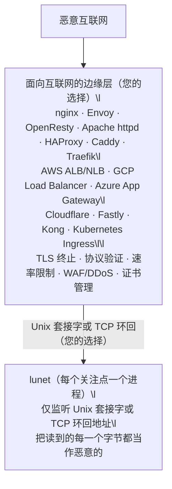

# 安全架构

lunet 推荐 qmail 风格的进程隔离架构——这正是让 qmail 在十多年间成为最安全邮件服务器的方法。

核心原则：将系统分解为信任边界，每个进程具有最小权限，并通过受限接口进行通信。面向互联网的攻击面由经过加固、久经考验的软件处理 —— 云负载均衡器、API 网关，或本地 sidecar（nginx、OpenResty、HAProxy、Traefik、Caddy、Envoy）；lunet 永远不直接接触恶意网络。

## 边缘层是暴露面边界，不是内存安全边界

边缘层移除的是 lunet 的**网络暴露面**：互联网上未认证的攻击者根本够不到 lunet 的套接字。对于边缘层原生讲的协议 —— HTTP/1.1、HTTP/2、HTTP/3、WebSocket —— 它还会做真正的协议验证：畸形帧、超大头部、协议层滥用，都会在任何字节到达 lunet 之前被拒绝。这正是 qmail 模型的核心：一个组件交给下一个组件的东西，已经由一个讲该协议的组件验证过了。

对于其他一切，边缘层很大程度上只是未验证地转发字节：

- L4 负载均衡器（NLB、TCP 模式的 HAProxy、nginx `stream`）看到的是包，不是协议。
- L7 代理只验证**它自己**讲的协议，不验证 lunet 讲的协议。nginx 的 HTTP 前端会毫无怨言地把恶意的自定义二进制流反向代理到 lunet 的环回套接字。

所以 lunet 自己的解析器仍然会收到攻击者控制的字节 —— 只不过来自环回或 Unix 套接字的对端。边缘层大幅压低了风险；它并没有让恶意输入变成不可能。把 lunet 读到的每个字节都当作恶意的：

- **先验证，后信任。** 在分配或复制之前强制执行长度前缀与帧边界。永远不要信任声明出的长度 —— 给它设上限。
- **加固运行时。** 在 lunet 或其 C/FFI 扩展模块直接操作内存之处，用栈保护（`-fstack-protector-strong`）、PIE/ASLR 与 `_FORTIFY_SOURCE=2` 构建。
- **约束进程。** 以匹配 Unix 套接字文件系统权限的专用非根 UID/GID 运行 lunet；施加 seccomp 或等效的系统调用过滤。
- **对每个解析器做模糊测试。** 在 CI 中对每个协议解码器跑覆盖率引导的模糊测试（libFuzzer/AFL++），而不只是 HTTP。

用 qmail 的话说：边缘层是面向网络的守卫，但每个组件仍必须假设自己的输入是恶意的。纵深防御正是这套架构的意义 —— 边缘层是第一道边界，不是唯一一道。

## 传输选项：Unix 套接字或 TCP 环回

两者都让 lunet 不接触网络；按你想让边界强制执行什么来选择：

| 选项 | 强制执行什么 | 考量 |
|------|------|------|
| TCP 环回（`127.0.0.1` / `::1`） | 无网络暴露；任何本地进程都可连接 | IP 形态：契合既有工具链与共享环回的容器；被攻击的本地服务、容器逃逸或配置错误的防火墙规则都可能够到它 |
| Unix 域套接字 | 无网络暴露；只有具有正确 UID/GID 的进程才能连接 | 文件系统权限就是边界：让套接字属主匹配 lunet 进程的专用 UID/GID；需要边缘层与 lunet 同处一个文件系统 |

## 出站 TLS 客户端（可选）

本文档中“在边缘终止 TLS”的建议针对的是**入站暴露面**，并不禁止出站 HTTPS 客户端流量。

某些应用（例如调用 LLM 提供商的 MCP 服务器）需要出站 HTTPS，但不需要接收入站的公网 HTTPS 连接。
此时应保持入站绑定仅限 Unix 套接字或 `127.0.0.1`，并通过出站客户端模块访问远程 API。

Lunet 支持一个可选的**仅客户端** HTTPS 模块：
- `lunet.httpc`（libcurl），用于出站 `https://...` 请求

默认开启 TLS 校验。仅用于开发的逃生阀可通过 `LUNET_HTTPC_INSECURE=1` 启用（生产环境不要使用）。
