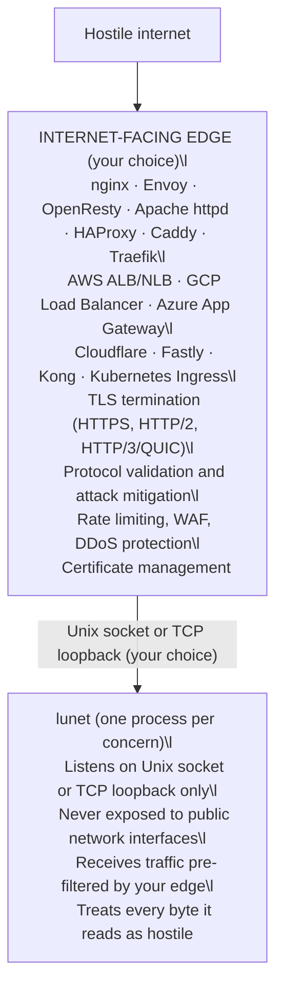

# Security Architecture

lunet recommends a qmail-style process isolation architecture - the same
approach that made qmail the most secure mail server for over a decade.

The principle: decompose your system into trust boundaries where each
process has minimal privilege and communicates through constrained
interfaces. The internet-facing attack surface is handled by hardened,
battle-tested software - a cloud load balancer, an API gateway, or a local
sidecar such as nginx, OpenResty, HAProxy, Traefik, Caddy, Envoy - and lunet
never touches the hostile network directly.



Software usable in each role:

| Role | Software you can use |
|------|----------------------|
| Internet-facing edge | nginx · Envoy · OpenResty · Apache httpd · HAProxy · Caddy · Traefik · Kong |
| Cloud load balancing / gateway | AWS ALB/NLB · GCP Load Balancer · Azure App Gateway |
| Managed edge / WAF | Cloudflare · Fastly · Kubernetes Ingress |

## The edge, discussed

> **In the examples we name nginx. OpenResty, Envoy, and many other
> excellent products exist; we are simply naming a common one for
> illustration purposes.**

The idea behind the proxy is that it is protocol-aware: it terminates TLS,
parses the protocol it speaks, checks the request, and forwards a complete,
well-formed payload. A good edge service can terminate TLS and also adapt
protocols above HTTP/1.1 - HTTP/2, HTTP/3 - so traffic over the internet
may be negotiated to the best the client supports, then handed to lunet as
plain HTTP/1.1 over a local socket. We are deliberately agnostic about
which product does this: the requirements are the job, not the brand.

The edge also owns the client-facing connections: it manages the
termination of encryption, and it can hold connection keep-alives open
over the internet - serving many requests over one connection at the
client's pace - while lunet sees only the local socket. The connection
budget that makes that possible (file-descriptor limits, worker
connection counts, keep-alive timeouts) is the edge's side of the
contract; the worked settings live in
[ext/http/README.md](../ext/http/README.md).

Products and defaults change. **Always read the latest documentation** of
whichever edge you deploy to understand what it currently does.

The reason this matters is fragmentation. nginx buffers a client request
before forwarding it. Per its documentation, with `proxy_request_buffering`
on (the default), "the entire request body is read from the client before
sending the request to a proxied server"; the request line and header
fields are parsed at the edge (a request line past one buffer answers 414,
an oversized field answers 400), and a client that does not transmit the
entire header within `client_header_timeout` is cut off with 408. An
attacker sending single bytes - dribbling a request one fragment at a time
to hold connections open and stress the backend - is absorbed by the edge:
its timeouts end the connection, and lunet never sees the drip. The edge
will not pass through certain hostile sets of fragmented traffic at all;
malformed framing dies at the edge's own parser. That protection is the
point of this architecture.

One delta worth knowing when you pick an edge: full-request buffering is
nginx's default (opt-out), but Traefik and Envoy stream request bodies by
default - on those the buffering must be installed explicitly (a middleware
or a filter), or the backend's own body cap becomes the live one. The
worked, tested examples in
[ext/http/edge/](../ext/http/edge/README.md) make this
concrete: the same application behind nginx, OpenResty, Traefik, and
Envoy, each proven by a conformance suite (happy paths, oversize body,
oversize header section, drip-feed). Turning on request buffering -
wherever your edge exposes it - is what protects against pathological
drip-fed traffic; a sidecar proxy can carry that role where the main
edge does not.

## The nginx example

nginx can forward HTTP/1.1 over a Unix domain socket:

```nginx
location / {
    proxy_pass http://unix:/run/lunet/lunet.sock;
    proxy_http_version 1.1;   # the default since 1.29.7 - stated to be version-proof
    proxy_set_header Connection "";
}
```

The socket's filesystem permissions are the access control: the socket is
owned by a dedicated lunet account (mode `0660`) and the nginx workers
connect as a member of that group - the deployment runbook below carries
the exact setup. Locked down this way, nginx is the only process bound to
the network, and lunet does not bind a network interface at all: the Unix
domain socket is the only thing lunet listens to HTTP/1.1 over.

To be explicit, and repeated on purpose: **this is not a recommendation
that nginx is the best edge proxy.** It is one worked example of an edge
that lets lunet stay off the network entirely, fronted by software for
which you can get mainstream software updates and security fixes. The full
annotated settings block - caps aligned to lunet's, the dribble timeouts,
request buffering stated on purpose - lives in
[ext/http/README.md](../ext/http/README.md).

> In the opinion of the author, running a very common edge software product
> that ships with major Linux distros and gets many years of security
> updates is far better than installing a custom product that might have
> some more features where you are not going to get automated software
> updates; and for that reason your author continues to use a conservative
> choice of edge server. YMMV.

## Where validation lives in this architecture

The edge removes lunet's **network exposure**: an unauthenticated attacker
on the internet cannot reach lunet's socket at all. For protocols the edge
speaks natively (HTTP/1.1, HTTP/2, HTTP/3, WebSocket) it validates the
protocol before handoff, so what reaches lunet has already been checked by a
component that speaks that protocol. That is the qmail model's core.

For everything else, the edge forwards bytes: an L4 load balancer sees
packets, not protocols; an L7 proxy validates the protocol it speaks, not
the protocol lunet speaks. In those deployments lunet's own protocol layer
does the validation. That division is deliberate: each wire protocol is
checked exactly once, by the component that speaks it on that hop.

The standing discipline for every byte lunet reads, wherever you deploy:

- **Bounds before allocation.** Declared lengths are capped, never trusted;
  length-prefix and frame checks run before allocating or copying.
- **Constrain the process.** Run lunet under a dedicated non-root UID/GID;
  match the Unix socket's filesystem permissions to it; apply seccomp or
  equivalent syscall filtering where the platform offers it.
- **Keep the probes green.** The parser suites and the Http11Probe rig pin
  the documented outcomes; keep fuzz coverage growing with new decoders.

In qmail terms: the edge is the network-facing guard, and every component
still assumes its inputs are hostile. Defense in depth is the point of this
architecture: the edge is the first boundary, not the only one.

## Constrain the process: deployment runbook

The "Constrain the process" bullet above is the policy; this section is the
mechanics. Apply all three layers on every host.

### Dedicated non-root UID/GID

Create a dedicated account and group for the lunet process; never run it as
root, and never share the account with another service.

```sh
groupadd --system lunet
useradd --system --gid lunet --home-dir /var/lib/lunet --create-home --shell /usr/sbin/nologin lunet
```

On macOS use `dscl`/`sysadminctl` equivalents; on Windows use a dedicated
service account with "Log on as a service" rights. Keep the account's UID/GID
stable across upgrades so socket ownership does not drift.

### Unix socket permissions

Bind lunet to a Unix socket owned by the dedicated account, mode `0660`, in a
directory owned by the same account with mode `0750`:

```sh
install -d -o lunet -g lunet -m 0750 /run/lunet
# lunet creates /run/lunet/lunet.sock with mode 0660, owner lunet:lunet
```

The edge (nginx, HAProxy, ...) connects as a member of the `lunet` group, or
runs as the same dedicated account. No other local user can open the socket.
On startup lunet unlinks a stale socket path only if it owns it; on exit it
removes the path. Verify with `ls -l /run/lunet/`.

### Syscall filtering (seccomp and equivalents)

Apply the strictest filter the platform offers:

- Linux: seccomp-bpf in `SCMP_ACT_KILL_PROCESS` (or `SECCOMP_RET_TRAP`) mode,
  allow-listing only the syscalls lunet needs (read, write, epoll_wait,
  accept4, close, mmap, mprotect, futex, clock_gettime, ...). Build the
  profile with `scmp_sys_resolver` or a higher-level tool such as
  `systemd`'s `SystemCallFilter=`, `s6`'s `s6-applyuidgid` plus a seccomp
  helper, or a custom libseccomp program. Deny `execve`, `ptrace`,
  `mount`, `reboot`, and network syscalls beyond the already-bound socket.
- macOS: `sandbox-exec` profile (or the Seatbelt API) restricting file and
  network access to the socket path and loopback.
- Windows: Job Objects with restricted tokens and `PROCESS_CREATION_MITIGATION_POLICY`
  (DEP, ASLR, strict handle checks); run under a low-integrity or
  AppContainer profile where feasible.
- FreeBSD/OpenBSD: `capsicum` / `pledge` / `unveil` with the minimal
  capability set.

The filter is a defense-in-depth layer: it does not replace input validation,
and input validation does not replace the filter.

### Release-build hardening flags

`xmake build-release` compiles every C target with the following flags (visible
in the build log as `release hardening flags: ...`):

- Linux: `-fstack-protector-strong`, `_FORTIFY_SOURCE=2`, and `-fPIE`/`-pie`
  on the executable targets (shared objects stay PIC). Verify with
  `readelf -h <binary>` (type `ET_DYN`, PIE) and `nm -D <binary> | grep stack_chk`
  (dynamic table; plain `nm` reads the stripped regular symbol table).
- macOS: the same flags; verify with `otool -hv <binary> | grep PIE` and
  `nm <binary> | grep stack_chk`.
- Windows: `/GS` (stack canaries). PIE/ASLR is provided by the linker default
  `/DYNAMICBASE`; `/GS` is the flag lunet sets explicitly.
- All platforms: stack canaries are present on every C target in `src/` and the
  `ext/` C modules.

Verify a shipped binary directly:

```sh
# macOS
otool -hv /path/to/lunet-run | grep PIE
nm /path/to/lunet-run | grep stack_chk

# Linux
readelf -h /path/to/lunet-run | grep 'Type:.*DYN'
nm -D /path/to/lunet-run | grep stack_chk
```

The flags are applied only in release mode (`is_mode("release")`); non-release
builds do not get these explicit flags. Note that a release build keeps them
even with `--lunet_trace=y` / `--lunet_verbose_trace=y`, because tracing is
independent of build mode. The docs state only the flags the build actually
applies — there are no aspirational entries.

### Example units

systemd (`/etc/systemd/system/lunet.service`):

```ini
[Unit]
Description=lunet application server
After=network.target

[Service]
Type=simple
User=lunet
Group=lunet
RuntimeDirectory=lunet
RuntimeDirectoryMode=0750
ExecStart=/usr/local/bin/lunet-run /opt/lunet/app.lua
Restart=on-failure
NoNewPrivileges=yes
PrivateTmp=yes
ProtectSystem=strict
ProtectHome=yes
ReadWritePaths=/run/lunet /var/lib/lunet
SystemCallFilter=@system-service
SystemCallErrorNumber=EPERM

[Install]
WantedBy=multi-user.target
```

s6 (`/etc/s6/sv/lunet/run`):

```sh
#!/bin/execlineb -P
s6-setuidgid lunet
/usr/local/bin/lunet-run /opt/lunet/app.lua
```

launchd (`/Library/LaunchDaemons/de.example.lunet.plist`):

```xml
<?xml version="1.0" encoding="UTF-8"?>
<!DOCTYPE plist PUBLIC "-//Apple//DTD PLIST 1.0//EN" "http://www.apple.com/DTDs/PropertyList-1.0.dtd">
<plist version="1.0">
<dict>
    <key>Label</key>
    <string>de.example.lunet</string>
    <key>ProgramArguments</key>
    <array>
        <string>/usr/local/bin/lunet-run</string>
        <string>/opt/lunet/app.lua</string>
    </array>
    <key>UserName</key>
    <string>lunet</string>
    <key>GroupName</key>
    <string>lunet</string>
    <key>RunAtLoad</key>
    <true/>
    <key>KeepAlive</key>
    <true/>
</dict>
</plist>
```

## Transport options: Unix socket or TCP loopback

Both keep lunet off the network; pick by what you want the boundary to
enforce:

| Option | What it enforces | Considerations |
|--------|------------------|----------------|
| TCP loopback (`127.0.0.1` / `::1`) | No network exposure; any local process may connect | IP-shaped: fits existing tooling and containers with shared loopback; a compromised local service, container escape, or misconfigured firewall rule can reach it |
| Unix domain socket | No network exposure; only processes with the correct UID/GID may connect | Filesystem permissions are the boundary: match the socket's owner to the lunet process's dedicated UID/GID; needs the edge and lunet on one filesystem |

## Outbound TLS clients (optional)

This document's "terminate TLS at the edge" guidance is about **inbound
exposure**. It does not prohibit outbound HTTPS client traffic.

Some applications (e.g. MCP servers calling LLM providers) need outbound
HTTPS but do not need to accept inbound public HTTPS connections. In that
case, keep inbound binding restricted to Unix sockets or `127.0.0.1`, and
use an outbound client module for remote APIs.

Lunet supports an optional **client-only** HTTPS module:
- `lunet.httpc` (libcurl) for outbound `https://...` requests

TLS verification is enabled by default. A development-only escape hatch may
be enabled via `LUNET_HTTPC_INSECURE=1` (do not use in production).
