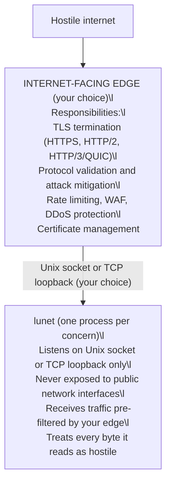

# Security Architecture

lunet recommends a qmail-style process isolation architecture - the same
approach that made qmail the most secure mail server for over a decade.

The principle: decompose your system into trust boundaries where each
process has minimal privilege and communicates through constrained
interfaces. The internet-facing attack surface is handled by hardened,
battle-tested software - a cloud load balancer, an API gateway, or a local
sidecar such as nginx, OpenResty, HAProxy, Traefik, Caddy, Envoy - and lunet
never touches the hostile network directly.

Software usable in each role:

| Role | Software you can use |
|------|----------------------|
| Internet-facing edge | nginx · Envoy · OpenResty · Apache httpd · HAProxy · Caddy · Traefik · Kong |
| Cloud load balancing / gateway | AWS ALB/NLB · GCP Load Balancer · Azure App Gateway |
| Managed edge / WAF | Cloudflare · Fastly · Kubernetes Ingress |

## Where validation lives in this architecture

The edge removes lunet's **network exposure**: an unauthenticated attacker
on the internet cannot reach lunet's socket at all. For protocols the edge
speaks natively (HTTP/1.1, HTTP/2, HTTP/3, WebSocket) it validates the
protocol before handoff, so what reaches lunet has already been checked by a
component that speaks that protocol. That is the qmail model's core.

For everything else, the edge forwards bytes: an L4 load balancer sees
packets, not protocols; an L7 proxy validates the protocol it speaks, not
the protocol lunet speaks. In those deployments lunet's own protocol layer
does the validation. That division is deliberate: each wire protocol is
checked exactly once, by the component that speaks it on that hop.

The standing discipline for every byte lunet reads, wherever you deploy:

- **Bounds before allocation.** Declared lengths are capped, never trusted;
  length-prefix and frame checks run before allocating or copying.
- **Constrain the process.** Run lunet under a dedicated non-root UID/GID;
  match the Unix socket's filesystem permissions to it; apply seccomp or
  equivalent syscall filtering where the platform offers it.
- **Keep the probes green.** The parser suites and the Http11Probe rig pin
  the documented outcomes; keep fuzz coverage growing with new decoders.

In qmail terms: the edge is the network-facing guard, and every component
still assumes its inputs are hostile. Defense in depth is the point of this
architecture: the edge is the first boundary, not the only one.

## Transport options: Unix socket or TCP loopback

Both keep lunet off the network; pick by what you want the boundary to
enforce:

| Option | What it enforces | Considerations |
|--------|------------------|----------------|
| TCP loopback (`127.0.0.1` / `::1`) | No network exposure; any local process may connect | IP-shaped: fits existing tooling and containers with shared loopback; a compromised local service, container escape, or misconfigured firewall rule can reach it |
| Unix domain socket | No network exposure; only processes with the correct UID/GID may connect | Filesystem permissions are the boundary: match the socket's owner to the lunet process's dedicated UID/GID; needs the edge and lunet on one filesystem |

## Outbound TLS clients (optional)

This document's "terminate TLS at the edge" guidance is about **inbound
exposure**. It does not prohibit outbound HTTPS client traffic.

Some applications (e.g. MCP servers calling LLM providers) need outbound
HTTPS but do not need to accept inbound public HTTPS connections. In that
case, keep inbound binding restricted to Unix sockets or `127.0.0.1`, and
use an outbound client module for remote APIs.

Lunet supports an optional **client-only** HTTPS module:
- `lunet.httpc` (libcurl) for outbound `https://...` requests

TLS verification is enabled by default. A development-only escape hatch may
be enabled via `LUNET_HTTPC_INSECURE=1` (do not use in production).
