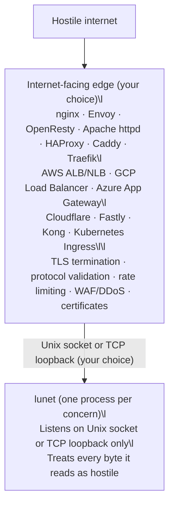

# Security Architecture

lunet recommends a qmail-style process isolation architecture — the same
approach that made qmail the most secure mail server for over a decade.

The principle: decompose your system into trust boundaries where each
process has minimal privilege and communicates through constrained
interfaces. The internet-facing attack surface is handled by hardened,
battle-tested software — a cloud load balancer, an API gateway, or a local
sidecar such as nginx, OpenResty, HAProxy, Traefik, Caddy, Envoy — and lunet
never touches the hostile network directly.

## The edge is an exposure boundary, not a memory-safety boundary

The edge removes lunet's **network exposure**: an unauthenticated attacker
on the internet cannot reach lunet's socket at all. For protocols the edge
speaks natively — HTTP/1.1, HTTP/2, HTTP/3, WebSocket — it also performs real
protocol validation: malformed framing, oversized headers, and
protocol-level abuse are rejected before any byte reaches lunet. That is
the qmail model's core: what one component hands off to the next has
already been validated by a component that speaks that protocol.

For everything else, the edge largely forwards bytes unvalidated:

- An L4 load balancer (NLB, HAProxy in TCP mode, nginx `stream`) sees
  packets, not protocols.
- An L7 proxy validates the protocol *it* speaks, not the protocol lunet
  speaks. An nginx HTTP frontend will happily reverse-proxy a hostile
  custom binary stream to lunet's loopback socket.

So lunet's own parsers still receive attacker-controlled bytes — just from
a loopback or Unix-socket peer. The edge buys the risk down dramatically;
it does not make hostile input impossible. Treat every byte lunet reads as
hostile:

- **Validate before you trust.** Enforce length-prefix and frame bounds
  before allocating or copying. Never trust a declared length — cap it.
- **Harden the runtime.** Where lunet or its C/FFI extension modules touch
  memory directly, build with stack canaries (`-fstack-protector-strong`),
  PIE/ASLR, and `_FORTIFY_SOURCE=2`.
- **Constrain the process.** Run lunet as a dedicated non-root UID/GID
  matching the Unix socket's filesystem permissions; apply seccomp or
  equivalent syscall filtering.
- **Fuzz every parser.** Run coverage-guided fuzzing (libFuzzer/AFL++) on
  each protocol decoder in CI, not just HTTP.

In qmail terms: the edge is the network-facing guard, but every component
must still assume its inputs are hostile. Defense in depth is the point of
this architecture — the edge is the first boundary, not the only one.

## Transport options: Unix socket or TCP loopback

Both keep lunet off the network; pick by what you want the boundary to
enforce:

| Option | What it enforces | Considerations |
|--------|------------------|----------------|
| TCP loopback (`127.0.0.1` / `::1`) | No network exposure; any local process may connect | IP-shaped: fits existing tooling and containers with shared loopback; a compromised local service, container escape, or misconfigured firewall rule can reach it |
| Unix domain socket | No network exposure; only processes with the correct UID/GID may connect | Filesystem permissions are the boundary: match the socket's owner to the lunet process's dedicated UID/GID; needs the edge and lunet on one filesystem |

## Outbound TLS clients (optional)

This document's "terminate TLS at the edge" guidance is about **inbound
exposure**. It does not prohibit outbound HTTPS client traffic.

Some applications (e.g. MCP servers calling LLM providers) need outbound
HTTPS but do not need to accept inbound public HTTPS connections. In that
case, keep inbound binding restricted to Unix sockets or `127.0.0.1`, and
use an outbound client module for remote APIs.

Lunet supports an optional **client-only** HTTPS module:
- `lunet.httpc` (libcurl) for outbound `https://...` requests

TLS verification is enabled by default. A development-only escape hatch may
be enabled via `LUNET_HTTPC_INSECURE=1` (do not use in production).
